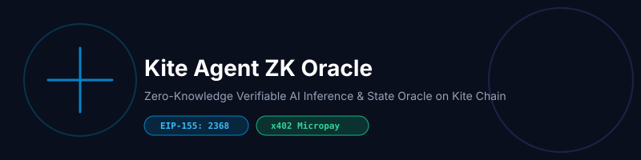
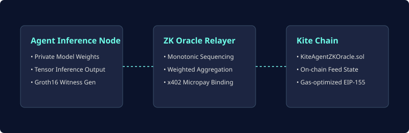

# Kite Agent ZK Oracle Protocol



[](LICENSE)
[](https://www.typescriptlang.org/)
[-0284c7)](https://gokite.ai)
[](https://gokite.ai)
[](https://gokite.ai)

> **Zero-Knowledge Verifiable Off-Chain AI Inference & Cross-Chain State Oracle with x402 Micropayments on Kite Chain.**

---

## 🌟 Overview

Autonomous AI Agents rely heavily on external state, LLM reasoning outputs, and real-time market data to execute on-chain smart contracts. Traditional centralized oracles introduce trust vulnerabilities and lack cryptographic verification for heavy model inferences.

**`kite-agent-zk-oracle`** provides:
- **ZK Verifiable AI Inference**: Cryptographically binds off-chain AI reasoning outputs to zero-knowledge Groth16 proofs, preventing hallucinations and malicious data tampering.
- **x402 Data Monetization**: Enables granular micro-payment streaming for data providers and agent compute nodes via EIP-712 payment authorization receipts over HTTP 402.
- **State Attestation Anchor**: Real-time monotonic state root sequencing on Kite Chain with replay-resistant epoch indexing.
- **Dual Network Support**: Pre-configured for Kite Testnet (EIP-155: `2368`) and Kite Mainnet (`2366`).

---

## 🏗️ Architecture



The protocol consists of three decoupled operational tiers:
1. **Agent Inference Node**: Executes private LLM/ML models, extracts decision tensors, and compiles zero-knowledge computation digests.
2. **ZK Oracle Gateway (Off-Chain Relayer)**: Batches multi-agent state attestations, verifies Groth16 proofs, and schedules gas-optimized rollups.
3. **On-Chain Oracle Registry (`contracts/KiteAgentZKOracle.sol`)**: Anchors verified oracle feeds directly into Kite Chain contracts for DApp consumption.

---

## 📦 Project Structure

```text
├── contracts/
│   ├── KiteAgentZKOracle.sol        # On-chain ZK oracle feed registry
│   └── MockInferenceVerifier.sol    # Test-bench Groth16 verifier contract
├── docs/
│   ├── architecture-spec.md         # Comprehensive oracle protocol specification
│   └── zk-inference-circuit-spec.md # Proof system constraints & public input formats
├── src/
│   ├── index.ts                     # Main entry point & public exports
│   ├── types.ts                     # Schema definitions & EIP-712 interfaces
│   ├── oracle.ts                    # Core ZK oracle verification engine
│   ├── feed.ts                      # Multi-source oracle feed aggregator
│   ├── pipeline.ts                  # Batch submission & failure policy pipeline
│   └── utils/
│       └── crypto.ts                # Domain-separated Keccak256 hash utilities
├── test/
│   ├── oracle.test.ts               # Unit & integration tests for oracle engine
│   ├── feed.test.ts                 # Aggregation & feed weighting tests
│   └── pipeline.test.ts             # Batch oracle pipeline tests
├── assets/                          # Architecture diagrams & branding assets
├── package.json
├── tsconfig.json
└── LICENSE
```

---

## 🚀 Quick Start

### Installation

```bash
git clone https://github.com/longxiaoLX/kite-agent-zk-oracle.git
cd kite-agent-zk-oracle
npm install
```

### Build & Typecheck

```bash
npm run build
```

### Run Test Suite

```bash
npm test
```

---

## 💡 Usage Example

```typescript
import {
  KiteZKOracleEngine,
  KITE_TESTNET_CONFIG,
  type AgentOracleProof
} from "kite-agent-zk-oracle";

// 1. Initialize ZK Oracle Engine
const oracle = new KiteZKOracleEngine(KITE_TESTNET_CONFIG, async (proof, publicInputs) => {
  // Validate Groth16 zero-knowledge proof against Kite verifier key
  return true;
});

// 2. Submit Verifiable Oracle Feed
const proof: AgentOracleProof = {
  feedId: "0xfeed000000000000000000000000000000000000000000000000000000000001",
  dataHash: "0x1234567890abcdef1234567890abcdef1234567890abcdef1234567890abcdef",
  value: 42000000000n, // e.g., $420.00 with 8 decimals
  computationEpoch: 1n,
  x402ReceiptHash: "0xabcdef1234567890abcdef1234567890abcdef1234567890abcdef1234567890",
  zkProof: "0x5678...01"
};

const result = await oracle.verifyOracleProof(proof);
console.log("Oracle Feed Verified:", result.valid);
console.log("Attestation Digest:", result.attestationDigest);
```

---

## 📄 License

Apache License 2.0. See [LICENSE](LICENSE) for details.
